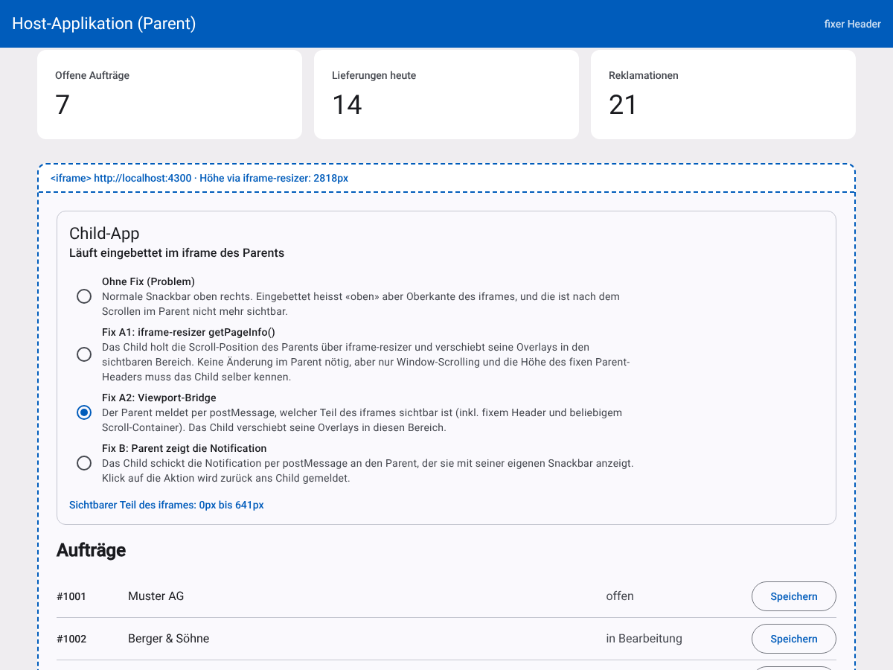
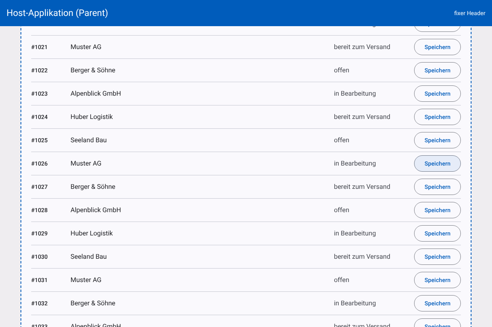
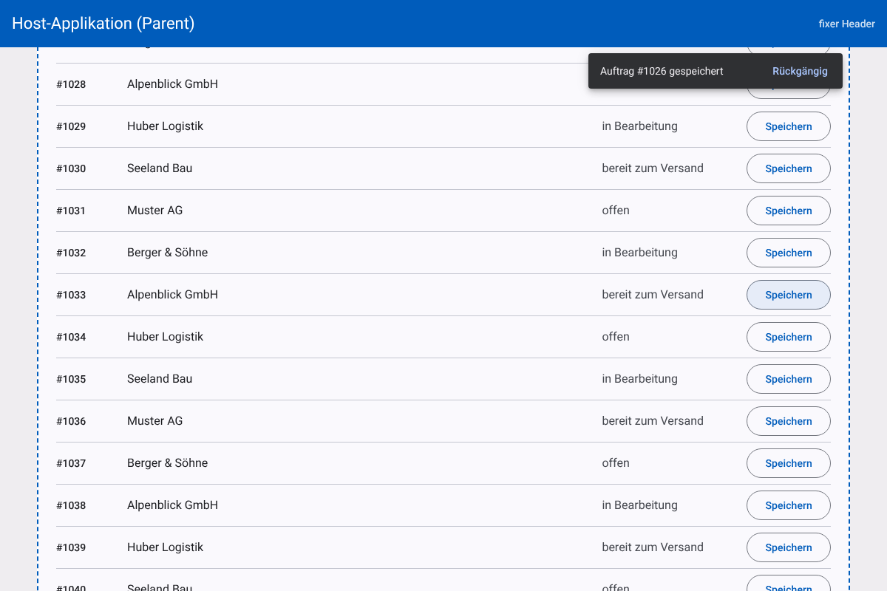
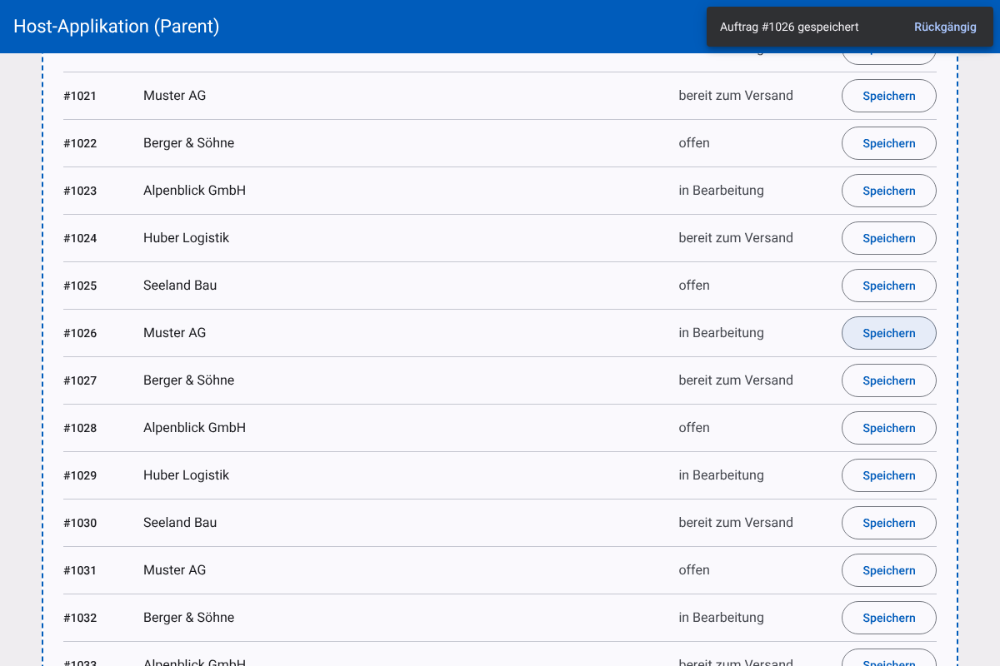

# iFrame-Notification Demo

Prototyp für folgendes Problem: Eine Angular-App läuft in einem `<iframe>` innerhalb einer anderen
Angular-App. [iframe-resizer](https://github.com/davidjbradshaw/iframe-resizer) (v4) macht das
iframe immer so hoch wie seinen Inhalt, darum scrollt nur der Parent. Notifications im iframe
(Angular Material Snackbar oben rechts) verschwinden, sobald man im Parent nach unten scrollt.

Der Prototyp stellt das Problem nach und zeigt drei Lösungsansätze. Zwischen den Ansätzen kann man
direkt im iframe umschalten.

## Starten

```bash
npm ci
npm start
```

- Parent (bindet das Child ein): http://localhost:4200
- Child standalone: http://localhost:4300

Parent und Child laufen auf unterschiedlichen Ports und damit auf unterschiedlichen Origins. Wie in
Produktion ist das iframe also cross-origin, und die Apps können nur per `postMessage`
miteinander reden.

Den Modus wählt man im iframe oder direkt über die URL, z.B. http://localhost:4200/?mode=bridge
(`none`, `resizer`, `bridge`, `parent`).



## Das Problem

```
 Parent-Fenster                          iframe (durch iframe-resizer ~2800px hoch)
┌──────────────────────────┐            ┌──────────────────────────┐
│ fixer Header             │            │            [Snackbar] ◄──── "oben rechts" im Child
├──────────────────────────┤            │                          │    = Oberkante des iframes
│                          │            │                          │
│                          │  scrollt   │          ...             │
│   sichtbarer Teil des    │ ◄────────► │                          │
│   iframes                │            │   #1026  [Speichern]  ◄──── hier wurde geklickt
│                          │            │          ...             │
└──────────────────────────┘            └──────────────────────────┘
```

Die Snackbar ist ein CDK-Overlay mit `position: fixed`. `fixed` bezieht sich auf den Viewport des
eigenen Dokuments, und für das Child-Dokument ist das iframe der Viewport. Weil iframe-resizer das
iframe so hoch wie den ganzen Inhalt macht, ist «oben rechts im Viewport» die Oberkante des iframes.
Hat der Parent darüber hinaus gescrollt, wird die Notification zwar angezeigt, aber ausserhalb des
sichtbaren Bereichs.

Standalone ist der Viewport das Browserfenster, dort funktioniert alles wie gewohnt.

Das Child kann das nicht alleine lösen: Es weiss nicht, wo das iframe im Parent liegt und wie weit
der Parent gescrollt ist. Cross-origin hat es keinen Zugriff auf `window.parent`.



_Modus «Ohne Fix»: Nach dem Klick auf «Speichern» bei #1026 wird die Notification angezeigt, liegt
aber rund 1500px weiter oben an der Oberkante des iframes._

## Lösungen

### Fix A: Overlays in den sichtbaren Bereich verschieben

Das Child bekommt laufend mitgeteilt, welcher Teil des iframes gerade im Parent sichtbar ist. Per CSS
wird dann der Wrapper der globalen CDK-Overlays (`.cdk-global-overlay-wrapper`) genau über diesen
Bereich gelegt ([`styles.scss`](projects/child/src/styles.scss)):

```scss
html.parent-viewport-sync .cdk-global-overlay-wrapper {
  top: var(--parent-viewport-top);
  height: var(--parent-viewport-height);
}
```

Die Snackbar selbst wird ganz normal geöffnet (`verticalPosition: 'top'`,
`horizontalPosition: 'end'`), sie richtet sich nur an einem kleineren «virtuellen Viewport» aus.
Den Wrapper verwenden alle Overlays mit `GlobalPositionStrategy`, das betrifft also auch `MatDialog`
(Dialoge werden im sichtbaren Bereich zentriert, im Demo nicht eingebaut). Menüs, Selects und
Autocomplete hängen an ihrem Auslöser-Element und bleiben unverändert.

Die Berechnung steckt in [`parent-viewport.ts`](projects/child/src/app/parent-viewport.ts). Für die
Herkunft der Position gibt es zwei Varianten:

#### A1: iframe-resizer `getPageInfo()` (nur das Child ändern)

Der Parent-Teil von iframe-resizer kann dem Child bereits Scroll-Position und Lage des iframes
melden: `window.parentIFrame.getPageInfo(callback)`. Im Parent muss nichts geändert werden.

Einschränkungen:

- iframe-resizer hört nur auf Scroll und Resize des **Windows**. Scrollt im Parent ein innerer
  Container (typisch bei `mat-sidenav-container`, dort scrollt `mat-sidenav-content`), kommen keine
  Updates. Getestet: Die Snackbar landet dann wieder ausserhalb.
- Fixe Elemente im Parent (Header) kennt iframe-resizer nicht. Das Child muss deren Höhe selber
  wissen (`PARENT_HEADER_HEIGHT`).
- Updates kommen gedrosselt (ca. alle 32ms).
- In iframe-resizer v5 heisst das Pendant `getParentProps()` (liefert u.a. `iframe.top` und
  `viewport.height`).

#### A2: Viewport-Bridge (kleine Erweiterung im Parent)

Eine Direktive im Parent
([`viewport-bridge.directive.ts`](projects/parent/src/app/viewport-bridge.directive.ts)) schickt bei
Scroll und Resize (höchstens einmal pro Frame) per `postMessage` die Oberkante des iframes, die
Unterkante des fixen Headers und die Unterkante des Viewports.

- Funktioniert mit jedem Scroll-Container, weil der Scroll-Listener im Capture-Modus auf `document`
  hängt. Getestet mit einem inneren Scroll-Container wie bei `mat-sidenav`.
- Der Parent kennt seinen Header selber, das Child muss nichts über das Parent-Layout wissen.
- Im Parent ist es nur ein Attribut auf dem iframe:

```html
<iframe [src]="childUrl" hostIframeResizer hostViewportBridge [fixedHeader]="header"></iframe>
```

**Gemeinsamer Nachteil von A1 und A2:** Beim Scrollen verschiebt der Browser das iframe sofort, die
Korrektur im Child kommt aber erst ein bis zwei Frames später per Message. Bei schnellem Scrollen
zieht die Snackbar deshalb leicht nach. Sobald nicht mehr gescrollt wird, steht sie wieder richtig.



_Modus «Fix A2»: Die Snackbar steht unter dem fixen Header des Parents und bleibt beim
Weiterscrollen dort._

### Fix B: Der Parent zeigt die Notification an

Das Child öffnet die Snackbar nicht selber, sondern schickt sie per `postMessage` an den Parent
([`notifications.ts`](projects/child/src/app/notifications.ts)). Der Parent öffnet sie mit seiner
eigenen `MatSnackBar`
([`notification-relay.directive.ts`](projects/parent/src/app/notification-relay.directive.ts)) und
meldet zurück, wenn sie geschlossen wurde und ob über die Aktion. So funktioniert auch
«Rückgängig» im Child.

- Echte Position im Parent-Viewport, nichts zieht beim Scrollen nach.
- Sieht aus wie die Notifications des Parents (gleiches Theme, nie zwei Snackbars gleichzeitig).
- Nur was sich serialisieren lässt: Text und eine Aktion. Eigene Snackbar-Komponenten
  (`openFromComponent`) gehen so nicht.
- Stärkere Kopplung: Der Parent muss das Protokoll kennen. Standalone braucht das Child einen
  Fallback auf die eigene Snackbar (im Demo umgesetzt).



## Vergleich

|                                       | A1 getPageInfo         | A2 Viewport-Bridge       | B Parent zeigt an        |
| ------------------------------------- | ---------------------- | ------------------------ | ------------------------ |
| Änderung im Parent                    | keine                  | Direktive auf dem iframe | Direktive auf dem iframe |
| Innerer Scroll-Container im Parent    | nein                   | ja                       | ja                       |
| Fixer Header im Parent                | Child muss Höhe kennen | ja                       | ja                       |
| Ruhig beim Scrollen                   | zieht leicht nach      | zieht leicht nach        | ja                       |
| Löst auch Dialoge im Child            | ja                     | ja                       | nein                     |
| Eigene Snackbar-Komponenten im Child  | ja                     | ja                       | nein                     |

## Empfehlung

Wenn beide Apps angepasst werden können: **A2** als generelle Lösung. Die Änderung im Parent ist
klein und generisch (sie weiss nichts von Notifications), das Child behält seine Notifications
komplett selber, und Dialoge sind gleich mit gelöst.

**B** lohnt sich, wenn Notifications ohnehin einheitlich über den Parent laufen sollen oder das
Nachziehen beim Scrollen stört. **A1** ist die Option, wenn der Parent nicht angepasst werden kann
und dort das Window scrollt.

## Struktur

```
projects/
  shared/iframe-protocol.ts             postMessage-Protokoll (Message-Typen, Ports)
  parent/src/app/
    app.html                            Host-Seite mit fixem Header und iframe
    iframe-resizer.directive.ts         Grundsetup: iframe-resizer, Parent-Teil
    viewport-bridge.directive.ts        Fix A2: meldet die Lage des iframes ans Child
    notification-relay.directive.ts     Fix B: zeigt Notifications des Childs an
  child/src/
    iframe-resizer-child.ts             Grundsetup: iframe-resizer, Child-Teil
    styles.scss                         Fix A: CSS für .cdk-global-overlay-wrapper
    app/parent-viewport.ts              Fix A1/A2: sichtbaren Bereich berechnen
    app/notifications.ts                Notification lokal oder via Parent (Fix B)
    app/notification-mode.ts            Modus-Umschaltung für die Demo
```

## Hinweise

- iframe-resizer 4.4.5 (MIT). Version 5 (`@iframe-resizer/parent` und `@iframe-resizer/child`) ist
  unter GPLv3 oder kommerzieller Lizenz verfügbar, das Prinzip bleibt dasselbe.
- Alle `postMessage`-Empfänger prüfen `event.origin` und `event.source`, gesendet wird immer an eine
  konkrete Ziel-Origin statt an `'*'`. Die Origins sind im Demo aus den Ports abgeleitet, in einer
  echten App kämen sie aus der Konfiguration.
- Angular 21 und Material 21, damit es mit Node 20.19+, 22 und 24 läuft.
